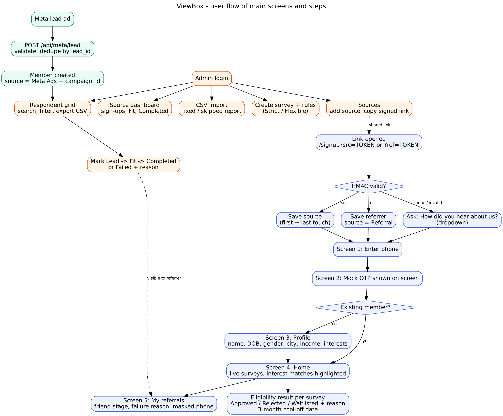
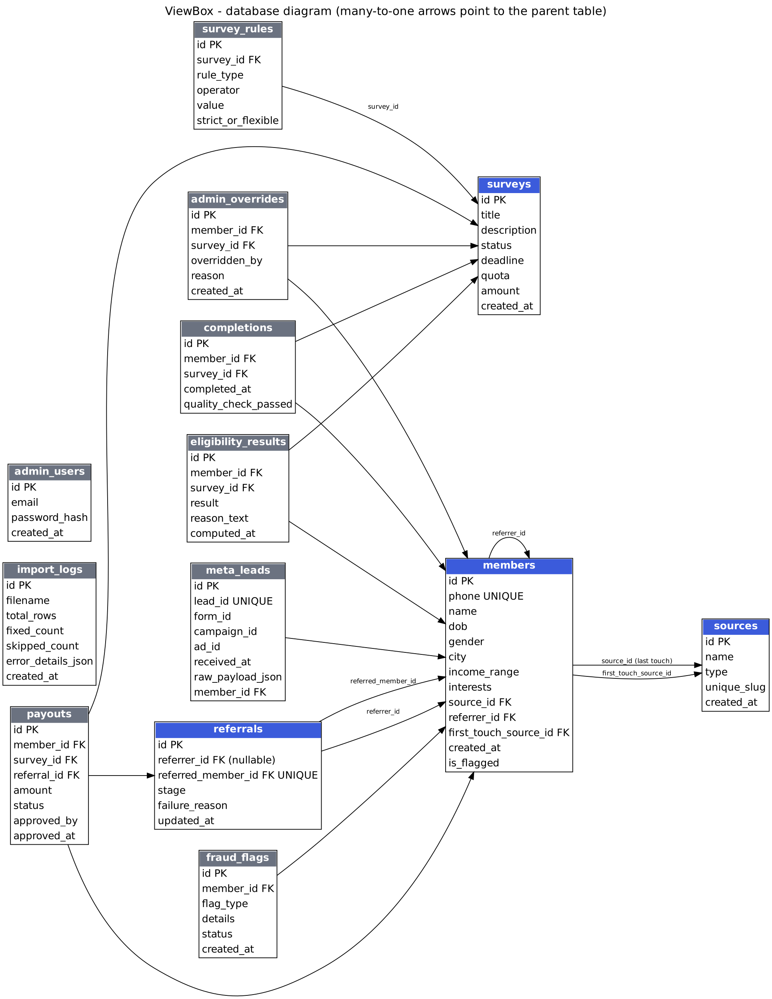

# ViewBox Panel System — Concave Insights (technical assessment)

## 1. Project Overview
ViewBox records where every survey panel member comes from (signed source/referral links), credits the right referrer through Lead → Fit → Completed, checks survey eligibility with plain-language reasons (incl. 3-month cool-off), and lets members see their own status. Ops get a searchable grid with CSV export, a source dashboard, messy-CSV import and a Meta lead-ads endpoint.

## 2. Tech Stack
- Backend: **FastAPI** (chosen over Flask for built-in Pydantic validation on every endpoint, typed schemas and auto docs at `/docs`), SQLAlchemy 2, Uvicorn
- Frontend: **React 18 + Vite + Tailwind CSS 4**, mobile-first, react-router. `npm run dev` proxies `/api` to the backend; `npm run build` writes `frontend/dist`, which the backend serves directly with an SPA fallback (deep links like `/admin/members` work without Vite)
- DB: SQLite. Libraries: pydantic, python-multipart, pytest, stdlib hmac/hashlib/csv
- Code layout: routes in `backend/app/routers/` (auth, member, admin, importer, meta), request/response schemas in `app/schemas.py`, business logic in `app/services/` (grid, importer, referral), shared guards and helpers in `app/deps.py` — `app/main.py` is a thin app factory (CORS, DB bootstrap, routers, SPA fallback)

## 3. Setup and Run (~2 min)
```bash
# terminal 1 — backend
cd backend
python3 -m venv .venv && source .venv/bin/activate   # Windows: .venv\Scripts\activate
pip install -r requirements.txt
cp .env.example .env            # optional; defaults work locally
python -m app.seed              # loads demo data
uvicorn app.main:app --port 8000

# terminal 2 — frontend
cd frontend
npm install
npm run dev                     # http://localhost:5173
```
Open http://localhost:5173 (UI) or http://localhost:8000 (serves `frontend/dist` if built, otherwise run the UI through Vite), and http://localhost:8000/docs (API).

Tests (backend API suite, uses its own throwaway DB):
```bash
cd backend && python -m pytest
```
Production-style run: `cd frontend && npm run build`, then start uvicorn — the backend serves the built app from `frontend/dist` at http://localhost:8000.

## 4. Demo Logins and Test Data
- Admin: `admin@concave.test` / `admin123`
- Members (OTP is shown on screen): `9000000001` Priya (referrer), `…04` Karan (in cool-off), `…06` Anita (age 17 → Rejected), `…02`/`…03`/`…07` Priya's friends (Lead/Fit/Failed)
- New signup: copy a link from Admin → Sources (`/signup?src=…`) or Priya's referral link from her home page
- Messy import sample: `data/viewbox_respondents_sample.csv` — the real 189-row export (odd dates, `+91` phones, M/F/female genders, duplicate numbers, blank rows) — plus the tiny toy `data/messy_sample.csv`
- Meta sample: see section 7

## 5. Features
| Feature | Status |
|---|---|
| Mock OTP auth + profiles, OTP rate limit (5/10 min) + per-IP signup limit (`SIGNUP_IP_LIMIT`/hour) | Done |
| Sources as data + HMAC-signed `?src=` / `?ref=` links | Done |
| "How did you hear about us?" fallback | Done |
| Eligibility engine (age/city/gender/income strict or flexible, quota, deadline) + reasons | Done |
| Every computed result saved to `eligibility_results` (one row per member+survey, updated on recompute) | Done |
| 3-month cool-off + re-eligibility date | Done |
| Referral stages, failure reason, referrer dashboard, masked phone | Done |
| Home with live surveys + interest highlight | Done |
| Admin grid: search-as-you-type, filters, CSV **and Excel** export of current view; filter by survey result (Approved / Rejected / Waitlisted) with plain-language reason per member | Done |
| Source dashboard (sign-ups / Fit / Completed) | Done |
| Messy CSV import with count + per-row reasons | Done — dry-run preview, per-row fixed / warned / skipped report; tested against the real `data/viewbox_respondents_sample.csv` (189 rows → 163 imported, 26 skipped; seeded run: 53 fixed, 110 warned) |
| Import preview before commit (dry-run, `?dry_run=true`) | Done — preview report, then Confirm import |
| `POST /api/meta/lead` (dedupe, invalid flagged); HMAC webhook signature when `META_WEBHOOK_SECRET` is set | Done |
| Empty / loading / error states | Done (manually checked, no UI tests) |
| Fraud flags + review queue (dup phone, self-referral, device/IP bursts, referral rings) | Done — detection on signup + on-demand scan; queue at Admin → Fraud queue; flags never deleted (Cleared/Confirmed) |
| Payout ledger / approval | Done — Payouts screen; Paid blocked until Approved (API-enforced) |
| Admin manual override | Done — endpoint + “Override…” in the members grid; engine honours it |
| Admin creates surveys + Strict/Flexible rules (UI) | Done |
| Ops marks Completed (survey + quality check) -> starts 3-month cool-off | Done |
| Member status panel (stage, completions, earnings) + referrer sees bonus status | Done |
| React + Vite + Tailwind frontend | Done |
| Automated tests (pytest API suite, 29 tests: eligibility outcomes + cool-off, HMAC link forgery, OTP + per-IP rate limits, messy import, Meta dedupe + webhook signature, admin-auth loop over every `/api/admin` route) | Done — `cd backend && python -m pytest` |
| Meta leads admin view + per-campaign breakdown | Done - Admin ? Meta leads; `GET /api/admin/meta-leads` + `/stats` |
| Tier 3 "wow" feature | Done - (b) LLM rule suggestion: Admin ? Surveys ? "Suggest rules" (LLM when `LLM_API_KEY` set, offline keyword fallback otherwise); suggestions are editable and only saved via Create survey |

## 6. Database Design
All tables from the brief exist in `backend/app/models.py`. Diagrams (PNG/SVG + Graphviz source) are in [`/design`](design/):  
One extension: `referrals` has one row per signup (nullable `referrer_id`) so ops can mark Fit/Completed for every member; `surveys.amount` was added for payouts.

## 7. API Endpoints
Interactive docs at `/docs`. Key ones:
| Method | URL | Purpose |
|---|---|---|
| POST | `/api/otp/request` `{phone}` | Mock OTP → `{otp,is_member}` |
| POST | `/api/login`, `/api/signup` | Auth / create member (`src`,`ref`,`how_heard_source_id`) |
| GET | `/api/me`, `/api/surveys`, `/api/me/referrals` | Member portal (phones masked) |
| POST/GET | `/api/admin/login`, `/api/admin/sources` | Admin auth; sources + signed links |
| GET | `/api/admin/members?q=&source_id=&city=&status=&survey_id=` | Grid; `status` accepts pipeline stages (Lead/Fit/Completed/Failed/flagged) or, with `survey_id`, Approved/Rejected/Waitlisted; each row then carries `eligibility:{result,reason}` (computed + saved to `eligibility_results`) |
| GET | `/api/admin/members/export` (+ same query filters) `&format=csv\|xlsx` | Same view as CSV or Excel (.xlsx, openpyxl); eligibility columns included when `survey_id` is given |
| POST | `/api/admin/referrals/{id}/stage` | `{stage:"Completed",survey_id:1,quality_check_passed:true}` records completion, starts cool-off, creates payouts; `{stage:"Failed",failure_reason:"…"}` |
| GET/POST | `/api/admin/surveys` | List / create survey with rules |
| GET/POST | `/api/admin/payouts`, `POST /api/admin/payouts/{id}/status` | Ledger; body `{status:"Approved"\|"Paid"}` (or `?status=`); Paid blocked until Approved |
| GET | `/api/me/status` | Member's own stage, completions, earnings |
| GET | `/api/admin/source-stats` | Per-source funnel |
| POST | `/api/admin/import` (+ `?dry_run=true`) | Multipart CSV → `{total_rows,imported,fixed,warned,skipped,details[]}`; dry-run validates only and writes nothing |
| GET | `/api/admin/fraud-flags?status=open\|Cleared\|Confirmed\|all` | Review queue |
| POST | `/api/admin/fraud-flags/{id}/review` `{status:"Cleared"\|"Confirmed",note?}` | Review a flag — rows are never deleted; clears the member's Flagged state when no open flags remain |
| POST | `/api/admin/fraud/scan` | Re-check all members for device/IP bursts and referral rings → `{flags_created}` |
| GET/POST | `/api/admin/overrides` `{member_id,survey_id,reason}`, DELETE `/api/admin/overrides/{id}` | Manual eligibility override (member then sees "Approved by ops after manual review") |
| POST | `/api/meta/lead` | Meta lead ad (webhook signature required when `META_WEBHOOK_SECRET` is set) |

Meta sample request → response:
```json
{"lead_id":"L1","form_id":"F1","campaign_id":"C9","ad_id":"A1","time":"2026-11-20T10:00:00Z",
 "fields":[{"name":"full_name","values":["Asha Rao"]},{"name":"phone_number","values":["+919822233344"]},{"name":"city","values":["Thane"]}]}
→ {"status":"created","member_id":14,"source":"Meta Ads","campaign_id":"C9"}
```
Repeat → `{"status":"duplicate"}`. Invalid phone/name → 422 (raw lead is stored for review). `fields` may also be a plain `{name,phone,city}` object.

How real Meta lead ads work: Meta calls your webhook with the lead ID, and your server then fetches the form fields from Meta's Graph API with an access token. This mock accepts the fields directly in the webhook body (the sample above). When `META_WEBHOOK_SECRET` is set, every call must carry `X-Hub-Signature-256: sha256=<HMAC-SHA256 of the raw body>` (or `X-Webhook-Token: <secret>`); unsigned or badly signed requests get 401. Without the secret the endpoint stays open for local dev and logs a warning.

## 8. Assumptions and Decisions
1. **Source conflict**: Instagram link + referrer → `source`=Instagram, `referrer_id`=member. Bonus goes to the referrer, source analytics to Instagram. A `?ref=` alone sets source to "Referral".
2. **First vs last touch**: the first signed link a visitor opens is remembered in the browser and sent as `first_src`; the link used at signup is `source_id` (last touch, for conversion). Both stored. Not done: a separate log of every visit.
3. **Payment Gateway Plan** (not connected — no gateway keys in this environment; the approval gate that must come first *is* built):
   **Gateway choice: Razorpay.** Reasoning: dominant in India, one integration covers UPI / cards / netbanking for receiving and a **Payouts API** (UPI + IMPS bank transfers) for paying members, full test/sandbox mode, signed webhooks, and docs good enough for a prototype.
   Steps from ops approval to money reaching the member:
   1. Ops clicks Approve → `POST /api/admin/payouts/{id}/status {"status":"Approved"}` (built; the API already refuses `Paid` unless the row is `Approved`).
   2. Backend calls `POST https://api.razorpay.com/v1/payouts` (HTTP Basic: `key_id:key_secret`) with `{account_number, mode:"UPI"|"IMPS", amount: <payout.amount × 100 (paise)>, currency:"INR", purpose:"payout", reference_id:"payout-<id>", notes:{payout_id}}`. `reference_id` = our payout id, so a retry can never double-pay (idempotency).
   3. Store `razorpay_payout_id` on the payout row; status → `Processing`.
   4. Razorpay calls our webhook `POST /webhooks/razorpay` with events `payout.processed` / `payout.failed`; we verify the `x-razorpay-signature` header (HMAC-SHA256 of the raw body with `RAZORPAY_WEBHOOK_SECRET`) before trusting it.
   5. `payout.processed` → mark `Paid`; `payout.failed` → back to `Approved` with the gateway error recorded, ops fixes the member's UPI/bank details and re-approves. Nothing is ever auto-deleted.
   6. Reconciliation job polls `GET /v1/payouts/{id}` for anything stuck in `Processing` > 24 h (covers missed webhooks), with retries at 5/30/120 min for `pending`. Failed after 3 attempts → surfaced on the Payouts screen for manual handling.
4. Cool-off = 90 days from last quality-passed completion. Invalid/forged links are ignored (signup still works) and the member is told.
5. Payout amounts: survey payment = `surveys.amount`; referral bonus = flat `REFERRAL_BONUS` (default 100, env). Cool-off starts only when the quality check passed; a failed quality check marks the stage Failed with a reason and creates no payout.
6. Pipeline stage is per signup row; "Failed" requires a reason.
7. **CSV import** (built around the real `data/viewbox_respondents_sample.csv`): `member_id`/`referred_by` are matched inside the file to credit referrers — a referrer whose row was skipped or missing is reported as "not imported", never guessed; `joined_on` sets the member's join date; `last_survey_completed_on` becomes a completion row (no survey, so no payout) which starts the 3-month cool-off, while the member's stage still starts at `Lead` until ops marks it; unknown source names are created as new sources (type `imported`) so nothing is silently dropped and the source dashboard stays complete; income values are mapped onto the three profile buckets (`<5L`, `5-10L`, `10L+`) because survey rules compare against those exact strings; unreadable dates, blank fields and self-referrals become `warned` rows in the report instead of failing the import.
**Security posture** (not "unhackable"): SQLAlchemy parameterised queries; Pydantic validation on bodies and query params; HMAC-SHA256 signed links (forged/wrong-kind tokens ignored, tested); OTP rate limit (5/10 min per phone) plus a per-IP signup limit (`SIGNUP_IP_LIMIT`); Meta webhook HMAC signature when `META_WEBHOOK_SECRET` is set; signed expiring tokens with PBKDF2 admin passwords; a test loops every `/api/admin` route to prove it answers 401 without a token; CORS limited to `FRONTEND_URL`; no secrets in repo; phones masked for members. Gaps: tokens are in localStorage, rate limits are in-process (single worker). Production: Postgres, Redis for sessions/OTP + rate limits, HTTPS, middleware rate limiting, audit logs, RBAC, CSP/HSTS.

## 9. Known Issues and Next Steps
- Not built: video walkthrough, UI tests (the pytest API suite covers the backend).
- Fraud detection uses signup-time `X-Forwarded-For` / `X-Device-Id`; behind a real proxy make sure `X-Forwarded-For` is set by the proxy (not the client) or bursts will group wrongly. Loopback/non-IP addresses are ignored.
- Roadmap (Tier 4): ML analytics with forecasting, Postgres/Redis scaling, production payment gateway flow (plan in section 8.3), LLM rule suggestions (admin-approved, never auto-committed), audit logs, RBAC, security headers.

