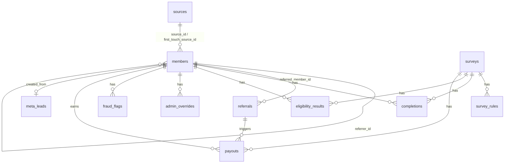

# Database diagram (frozen after Day 2)

Extension: `referrals` holds one row per signup (referrer_id nullable) so ops can mark Fit/Completed for every member; this drives per-source Fit/Completed counts.
